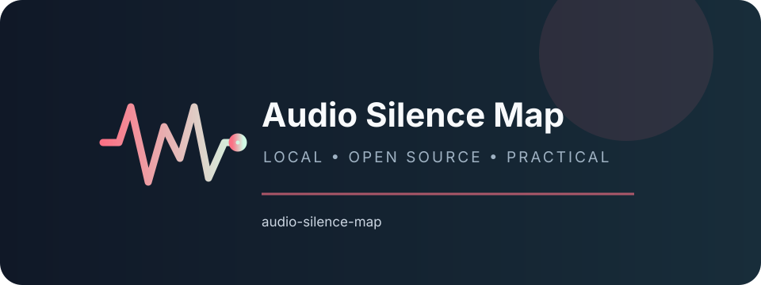

<p align="center"></p>
<p align="center"></p>
<p align="center">   </p>
<p align="center"></p>

## 🧭 Overview
Audio Silence Map scans uncompressed PCM WAV files and reports quiet intervals based on an RMS threshold. It is read-only and exports timestamps so you can review recordings without modifying the audio.

## ✨ Features
- 🔊 Supports 8-, 16-, 24-, and 32-bit PCM WAV files.
- 📉 Uses windowed RMS amplitude and a configurable dBFS threshold.
- ⏱️ Merges consecutive quiet windows and filters short gaps.
- 📤 Exports JSON or CSV timestamps without editing the source.

## 🎬 Demo
```text
$ python main.py recording.wav --threshold -42 --min-duration 0.4
Found 2 quiet interval(s)
00:12.40 – 00:13.10  (0.70s)
00:48.20 – 00:49.00  (0.80s)
```
This is a local example; files are processed in your browser or on your machine.

## 🚀 Quick Start
```bash
python -m pip install -r requirements.txt
python main.py recording.wav
```
Try `--format csv --output silence.csv`. The input must be an uncompressed PCM WAV file.

## 🧰 Tech Stack
- Python 3.10+
- wave, struct, math, csv, and json from the standard library
- unittest

## 🗂️ Folder Structure
```text
main.py
silence_map.py
tests/test_silence_map.py
requirements.txt
assets/overview.svg
```

## 🗺️ Roadmap
- [x] Core workflow
- [x] Local-first processing
- [ ] More format and edge-case coverage
- [ ] Optional CI examples

## 🤝 Contributing
Issues and focused pull requests are welcome. Add regression tests for bug fixes and document new behavior.

## 📄 License
Released under the [MIT License](LICENSE).

<p align="center"></p>
